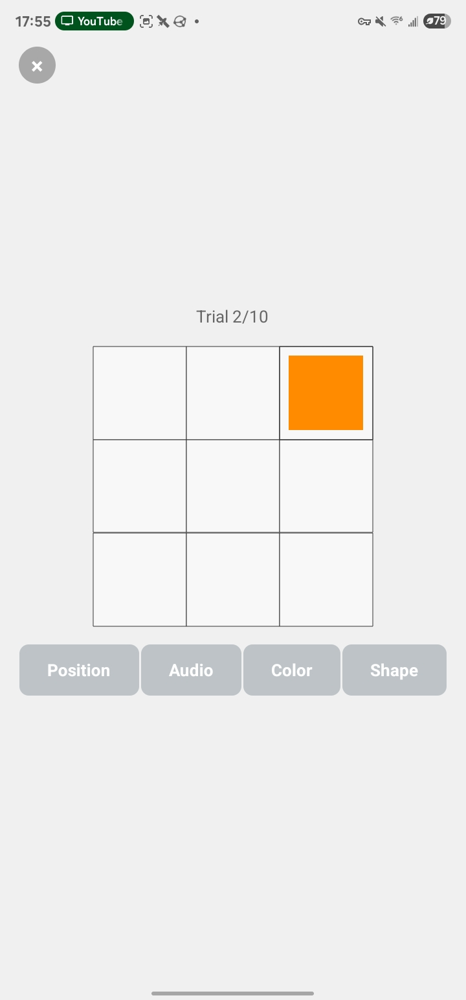
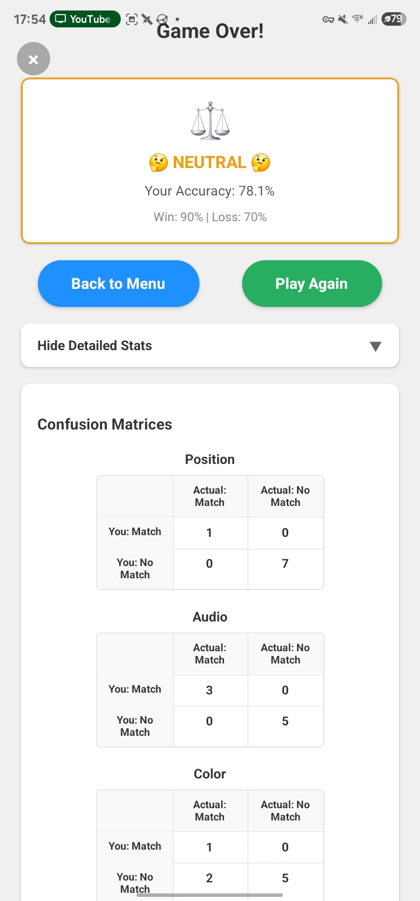
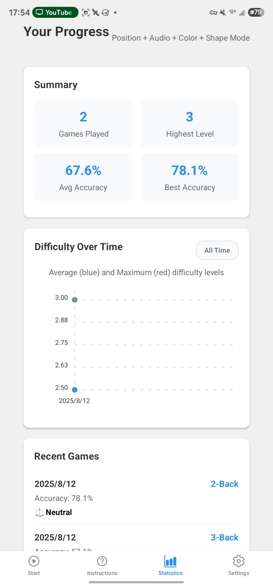

# N-back

N-back project written by Cursor with human guidance. There's a bug with sound going out that I need to fix still, but I think it's probably the best open source n-back game so far.

Features
- modern design
- quad n-back
- adjustable difficulty and settings
- auto-change difficulty with streaks in a session
- backup and restore
- stats screen with graphs

## images

